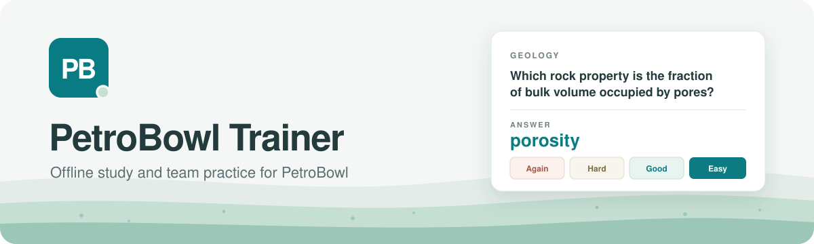
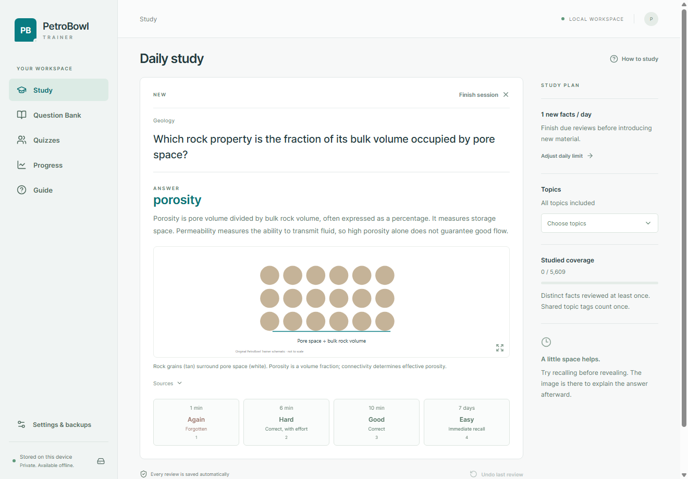
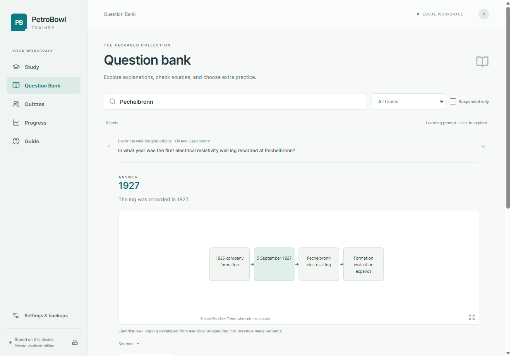
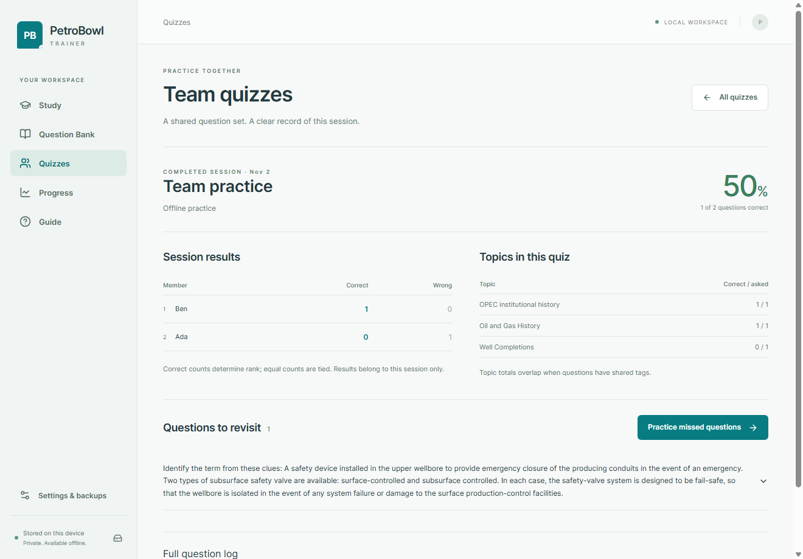
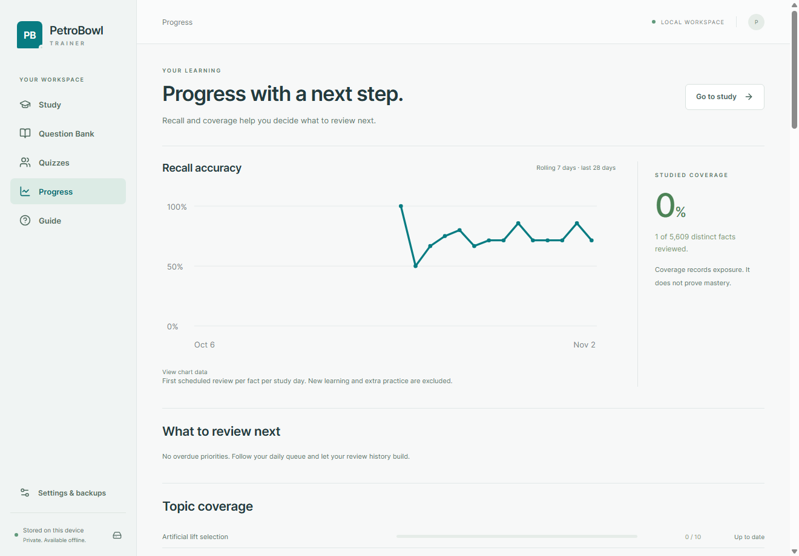
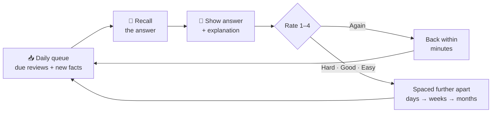

<picture>
  <source media="(prefers-color-scheme: dark)" srcset="docs/images/banner-dark.svg">
  
</picture>

<p align="center">
  <a href="https://github.com/67minutes/petrobowl-trainer-desktop/releases/latest"></a>
  
  
  <a href="LICENSE"></a>
</p>

<p align="center">
  <a href="https://github.com/67minutes/petrobowl-trainer-desktop/releases/latest"><b>⬇ Download for Windows</b></a>
  &nbsp;·&nbsp; <a href="#-install">Install guide</a>
  &nbsp;·&nbsp; <a href="#-using-the-app">How to use</a>
  &nbsp;·&nbsp; <a href="#-troubleshooting">Help</a>
</p>

<br>

PetroBowl Trainer is a desktop app for PetroBowl preparation. Study on your own with spaced repetition, then run quizmaster-led practice with your team. It runs entirely on your computer: no account, no internet connection, and nothing leaves the device.

<table>
  <tr>
    <td align="center" width="25%"><h3>5,609</h3>facts to study</td>
    <td align="center" width="25%"><h3>FSRS</h3>modern spaced-repetition scheduling</td>
    <td align="center" width="25%"><h3>100%</h3>offline and private</td>
    <td align="center" width="25%"><h3>0</h3>accounts or sign-ups</td>
  </tr>
</table>

<p align="center">
  
</p>

## ✨ Features

<table>
  <tr>
    <td width="50%" valign="top">
      <h3>📚 Study</h3>
      A daily queue of due reviews and new facts. Recall first, reveal the answer with its explanation and diagram, then rate yourself. Missed facts come back within minutes; known ones drift further apart.
    </td>
    <td width="50%" valign="top">
      <h3>🔎 Question Bank</h3>
      Search all 5,609 facts, filter by topic, read explanations and sources, practice extra cards, and suspend the ones you don't need.
      <br><br>
      
    </td>
  </tr>
  <tr>
    <td width="50%" valign="top">
      <h3>👥 Team quizzes</h3>
      Save rosters, draw balanced question sets across topics, record who buzzed, allow rebounds, and review a report. One click turns misses into a practice session.
      <br><br>
      
    </td>
    <td width="50%" valign="top">
      <h3>📈 Progress</h3>
      Rolling recall accuracy, coverage per topic, and a short list of what to review next.
      <br><br>
      
    </td>
  </tr>
</table>

Also included: a built-in **Guide** with a practice card that never touches your history, and **Settings** for your daily new-fact limit, target retention, and backups.

### How studying works



The scheduler predicts when you're about to forget each fact and brings it back just before then, so a few minutes a day keeps thousands of facts within reach.

## 💾 Install

> [!NOTE]
> **Requirements:** Windows 10 or 11 (64-bit) · about 450 MB of disk space · no administrator rights needed

1. **Download** `PetroBowl-Trainer-1.0.0-x64-Setup.exe` from the [latest release](https://github.com/67minutes/petrobowl-trainer-desktop/releases/latest).
2. **Run** the downloaded file.
3. If Windows shows **"Windows protected your PC"**, click **More info → Run anyway**. This appears because the installer isn't code-signed.
4. **Choose** an install folder (the default is fine) and click **Install**.
5. **Open** PetroBowl Trainer from the desktop shortcut or the Start menu.

A short welcome explains the workspace on first launch. After that, the app opens straight to Study.

<details>
<summary><b>Updating to a new version</b></summary>
<br>

Download the newer installer and run it. It replaces the app in place; your study history, settings, and rosters are kept, and facts that remain in the new version keep their schedules.

</details>

<details>
<summary><b>Uninstalling</b></summary>
<br>

Open **Windows Settings → Apps → Installed apps → PetroBowl Trainer → Uninstall**. Your learning history is kept so a later reinstall picks up where you stopped. To remove it too, delete `%APPDATA%\PetroBowl Trainer` after uninstalling.

</details>

## 🎯 Using the app

### Daily study

1. Open **Study** and press **Start studying**.
2. Read the prompt and recall the answer, then press <kbd>Space</kbd> (or click **Show answer**).
3. Rate how it went. Each button shows when you'll see the fact next.

   | Key | Rating | Use it when… |
   |:---:|---|---|
   | <kbd>1</kbd> | **Again** | you forgot it |
   | <kbd>2</kbd> | **Hard** | you got it, but with real difficulty |
   | <kbd>3</kbd> | **Good** | you got it with normal effort |
   | <kbd>4</kbd> | **Easy** | it was instant and certain |

4. Keep going until the queue is empty. Coming back daily matters more than long sessions.

> [!TIP]
> A new study day starts at **04:00** local time, so late-night sessions count toward the previous day. Use the topic filter beside the card to focus on your assigned areas.

### Team practice

1. Go to **Quizzes** and create a roster with your team members.
2. Choose topics, the number of questions, and the pool: **Full packaged bank** or **Studied on this computer**.
3. For each question, pick the player who buzzed and mark **Correct** or **Wrong**. After a wrong answer, another player can rebound.
4. Click **Finish quiz & view report** for player results and topic accuracy, then **Practice missed questions** to study the misses.

### Settings

| Setting | What it does |
|---|---|
| **New facts per day** | How many unseen facts join your queue each day. Lower it if reviews pile up; set 0 to focus on your backlog. |
| **Desired retention** | The recall rate the scheduler aims for (default 90%). Higher means more frequent reviews. |

## 🔒 Your data and backups

Your history is stored only on this computer, in `%APPDATA%\PetroBowl Trainer`. Each Windows user account has its own separate history.

- **Back up:** Settings → **Export learner backup** saves a `.json` file with your history, rosters, and quiz reports. Keep a copy on another drive, or use it to move to a new computer.
- **Restore:** Settings → **Restore a backup**. The file is validated first and your current data is saved before it's replaced; if the file isn't valid, nothing changes.

## 🛠 Troubleshooting

<details>
<summary><b>Windows blocks the installer</b></summary>
<br>
Click <b>More info</b>, then <b>Run anyway</b>. The warning appears because the installer isn't code-signed.
</details>

<details>
<summary><b>Opening the app again does nothing new</b></summary>
<br>
Only one copy runs at a time. Launching it again brings the existing window to the front.
</details>

<details>
<summary><b>"This data was created by a newer PetroBowl Trainer"</b></summary>
<br>
Your history came from a newer version of the app. Install the latest release.
</details>

<details>
<summary><b>Text or layout looks cramped</b></summary>
<br>
The app is designed for windows of at least 800 × 650 and display scaling up to 150%.
</details>

## 🗺 Roadmap

- [x] Spaced-repetition study, question bank, team quizzes, progress, backups
- [x] 5,609 facts across petroleum engineering, geoscience, history, and energy
- [ ] Explanatory diagrams for more facts (617 today)
- [ ] Continued review of question wording and sources
- [ ] Larger topic collections

## 👩‍💻 Development

<details>
<summary>Build from source</summary>
<br>

Requires Node.js 22 and Windows for packaging.

```powershell
npm ci
npm run dev                 # build and launch the app
npm test                    # unit tests (run under Electron's Node)
npm run typecheck
```

Content in `content/` is generated from the sources in `data/`:

```powershell
npm run content:build       # regenerate content/bank.json and manifest.json
npm run content:validate    # structural checks
npm run installer           # release gate + build + Windows installer in release/
```

See [content updates](docs/CONTENT-UPDATES.md), [QA inventory](docs/QA-INVENTORY.md), and [validation results](docs/VALIDATION.md).

</details>

## 📄 License

The application code is released under the [MIT License](LICENSE). Original diagrams are [CC BY 4.0](https://creativecommons.org/licenses/by/4.0/). Question content is compiled from third-party sources, chiefly the SLB Energy Glossary, and is **not** openly licensed — see [CONTENT-LICENSE.md](CONTENT-LICENSE.md).

PetroBowl Trainer is an independent study tool and is not affiliated with or endorsed by SPE or SLB.
